# BankOps AI

**Banking IT incident intelligence: AI-assisted root-cause analysis, multi-agent investigation, machine learning and management reporting, built with guardrails and human approval.**

**[▶ Try the live demo](https://bankops-ai-murex.vercel.app)** · [Architecture (interactive)](https://srinivasand04.github.io/bankops-ai-showcase/architecture.html) · [User guide](docs/user-guide.md) · [Sample management report (PDF)](docs/management-report-sample.pdf)

> This repository presents the idea, design and results of BankOps AI. **The source code is private.**
> All data in the demo is synthetic (plus one public, anonymised dataset); SLA targets are demonstration values.
> The free demo server sleeps when idle, so the first load can take about a minute.

---

## The problem

When a payment service fails at a bank, the operations team has to answer the same questions under pressure:
*What changed? What else is affected? Have we seen this before? Will we breach the SLA? What is the root cause?*
The answers are spread across incident tickets, change records, monitoring metrics, logs and dependency maps.

BankOps AI brings those sources together and uses AI to propose answers **with evidence**. It never acts alone: every
AI finding is a hypothesis until a human incident manager approves it.

## What it does

| Area | What you see |
|---|---|
| **Incident management** | Full lifecycle (open → investigating → resolved → closed), timeline, SLA tracking by severity, root-cause records, corrective and preventive actions (CAPA) |
| **Incident correlation** | Links an incident to recent changes and to upstream / downstream applications, so "release 2.4.1 went out 30 minutes before the HTTP 500s" is visible at once |
| **AI root-cause analysis** | One structured LLM call over a fact base where every fact has a citable evidence ID. Guardrails reject claims without evidence and keep facts and hypotheses apart |
| **Multi-agent investigation** | A LangGraph team: triage → supervisor → change, dependency and operational-risk specialists → root cause → human review. 10 read-only tools, every step audited |
| **Machine learning (ML Lab)** | 8 tasks, each comparing 2–4 algorithms on a time-based split; predictions appear on every incident and feed the AI as probabilistic evidence |
| **Management reports** | 5 reports across all applications (scorecard with RAG, SLA performance, trends, change risk, problem management), print to PDF and CSV |
| **Users and roles** | Viewer, Engineer, Incident manager, Administrator; the role always comes from the server, never from the browser |
| **English / French** | Every screen in both languages |

## AI guardrails: the AI advises, people decide

The AI **must not**: deploy code, roll back production, change production configuration, close critical incidents,
approve production changes or modify banking transactions. It is built so that it **cannot**:

- AI users have a reserved identity and the services refuse them closing incidents, confirming root causes or approving findings.
- Every claim must cite evidence IDs from the fact base; unknown IDs are removed and the change is recorded.
- Root causes are created only as *hypothesis* or *under review*; *confirmed* needs a human review, enforced in the database too.
- Agent tools are read-only. Daily limits cap AI usage on the public demo.

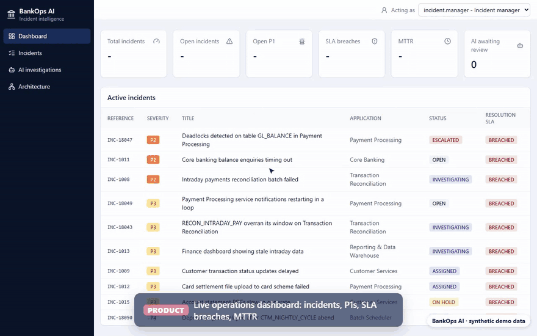

## AI root-cause analysis

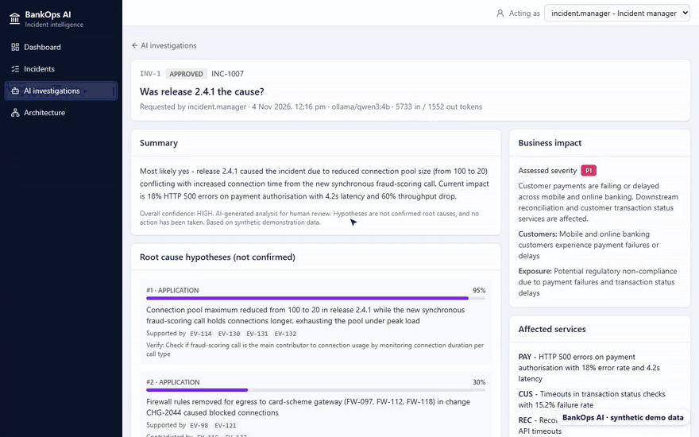

## Incident correlation

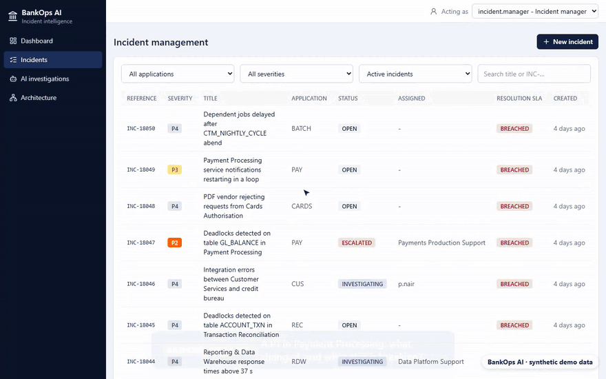

## Screens

| | |
|---|---|
| 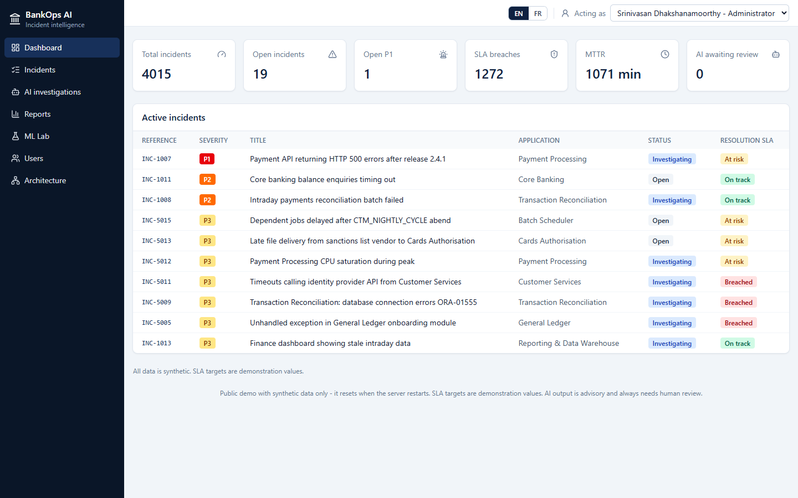 **Dashboard** | 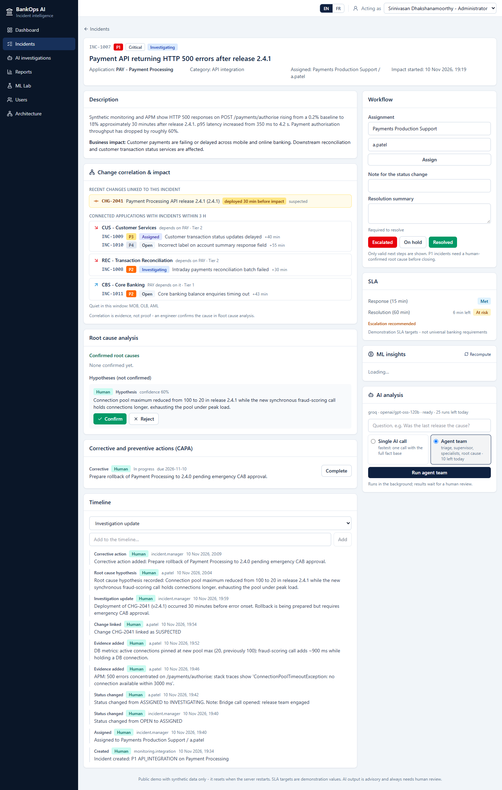 **Incident detail with ML insights and correlation** |
| 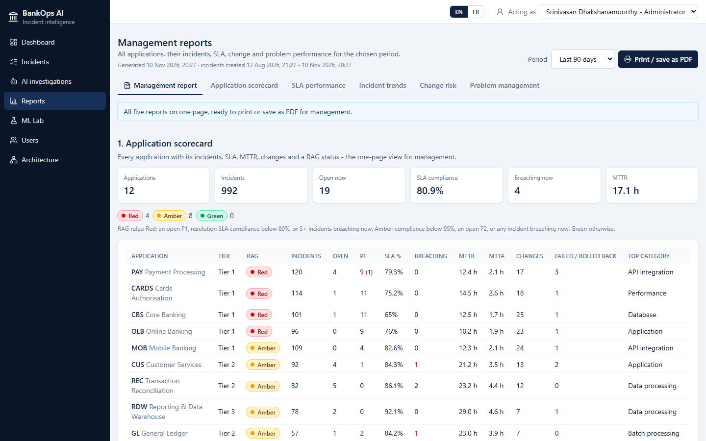 **Management reports** | 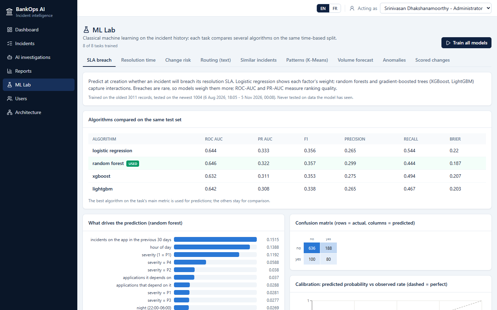 **ML Lab: algorithms compared on the same test set** |
| 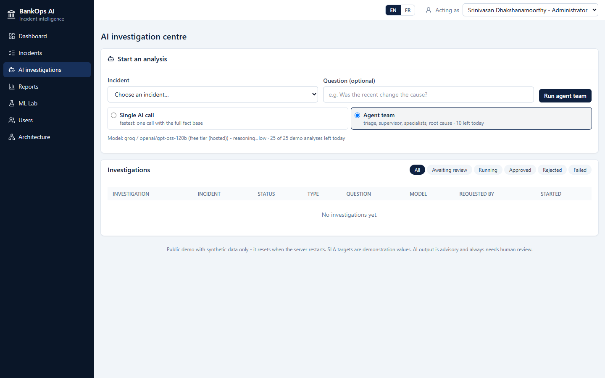 **AI investigations and review queue** | 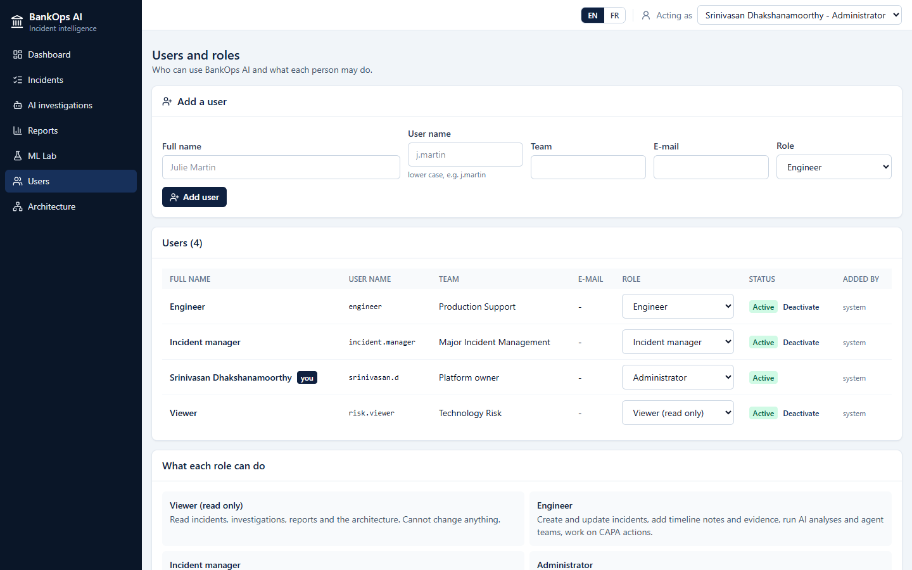 **Users and roles** |
| 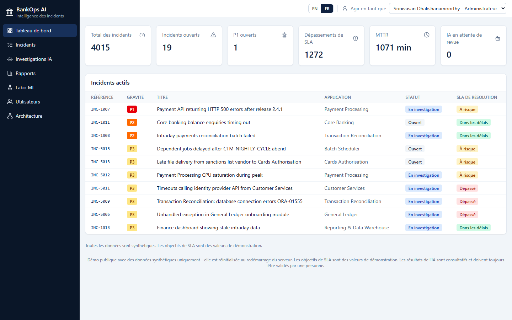 **The whole UI in French** | 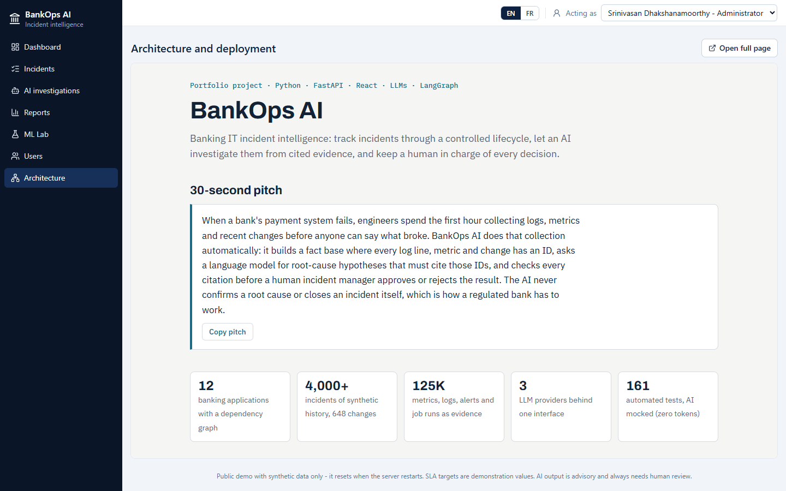 **Architecture page inside the app** |

## Machine learning results

Trained on the oldest 75% of 12 months of synthetic history and tested on the newest 25%, so no model ever sees the future.

| Task | Algorithms compared | Result (model used in **bold**) |
|---|---|---|
| Resolution time | **Linear regression on log(MTTR)**, gradient boosting | MAE **495 min**, R² 0.37 |
| SLA breach at creation | logistic regression, **random forest**, XGBoost, LightGBM | ROC-AUC **0.646** |
| Change risk | decision tree, random forest, **gradient boosting** | ROC-AUC **0.764** |
| Category routing from text | Naive Bayes, **linear SVM**, RBF SVM | macro-F1 **0.838**, team routing accuracy 0.88 |
| Similar incidents | **TF-IDF + SVD vectors in pgvector, KNN** | macro-F1 **0.807** |
| Incident patterns | **K-Means** (k by elbow + silhouette) | k = 10, silhouette 0.42 |
| Weekly volume forecast | seasonal naive, **Holt-Winters** | MAE **2.18** incidents / week |
| Metric anomalies | **rolling z-score**, seasonal residual | F1 **0.41** |

Honest limits and the reasoning behind each task: [docs/ml.md](docs/ml.md).

## Architecture

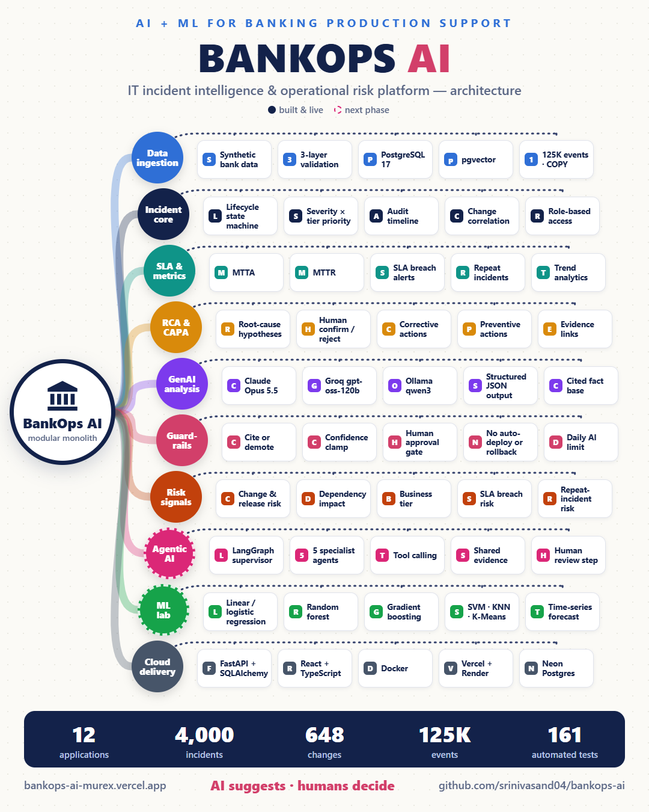

| Layer | Technology |
|---|---|
| Frontend | React, TypeScript, Vite, Tailwind CSS, Recharts |
| Backend | Python, FastAPI, SQLAlchemy 2, Alembic, Pydantic |
| Database | PostgreSQL 17 with pgvector |
| AI | Anthropic Claude, Groq or a local Ollama model (one setting), LangGraph for the agent team |
| ML | scikit-learn, XGBoost, LightGBM, statsmodels |
| Hosting (free tiers) | Vercel (UI), Render (API in Docker), Neon (PostgreSQL), Groq (LLM) |
| Quality | 212 automated tests against a real PostgreSQL test database, AI calls mocked |

## Data

- **Synthetic banking environment:** 12 applications (payments, core banking, cards, online and mobile banking, reconciliation and others) with dependencies, changes, metrics, logs, alerts and 4,000 incidents with deliberately designed patterns. See [docs/synthetic-data.md](docs/synthetic-data.md).
- **Real data:** 300 anonymised Rabobank IT incidents and 130 changes from the public BPI Challenge 2014, loaded through the same validation. See [docs/bpi2014.md](docs/bpi2014.md).

## Documentation

- [User guide: try every feature step by step](docs/user-guide.md)
- [Architecture and governance](docs/architecture.md)
- [AI root-cause analysis and guardrails](docs/ai-analysis.md)
- [Multi-agent investigation (LangGraph)](docs/agentic-ai.md)
- [Machine learning](docs/ml.md)
- [Synthetic data design](docs/synthetic-data.md)
- [Real data: BPI Challenge 2014](docs/bpi2014.md)
- [Banking concepts used (SLA, MTTR, RCA, CAPA, operational risk)](docs/banking-concepts.md)

## Source code

The source code is kept private. If you are a recruiter or hiring manager and would like a walkthrough or
temporary read access, please contact me through [GitHub](https://github.com/Srinivasand04) or LinkedIn.

© 2026 Srinivasan Dhakshanamoorthy. All rights reserved. See [LICENSE](LICENSE).
